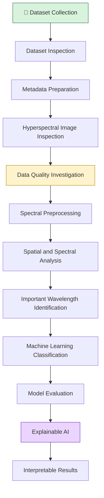
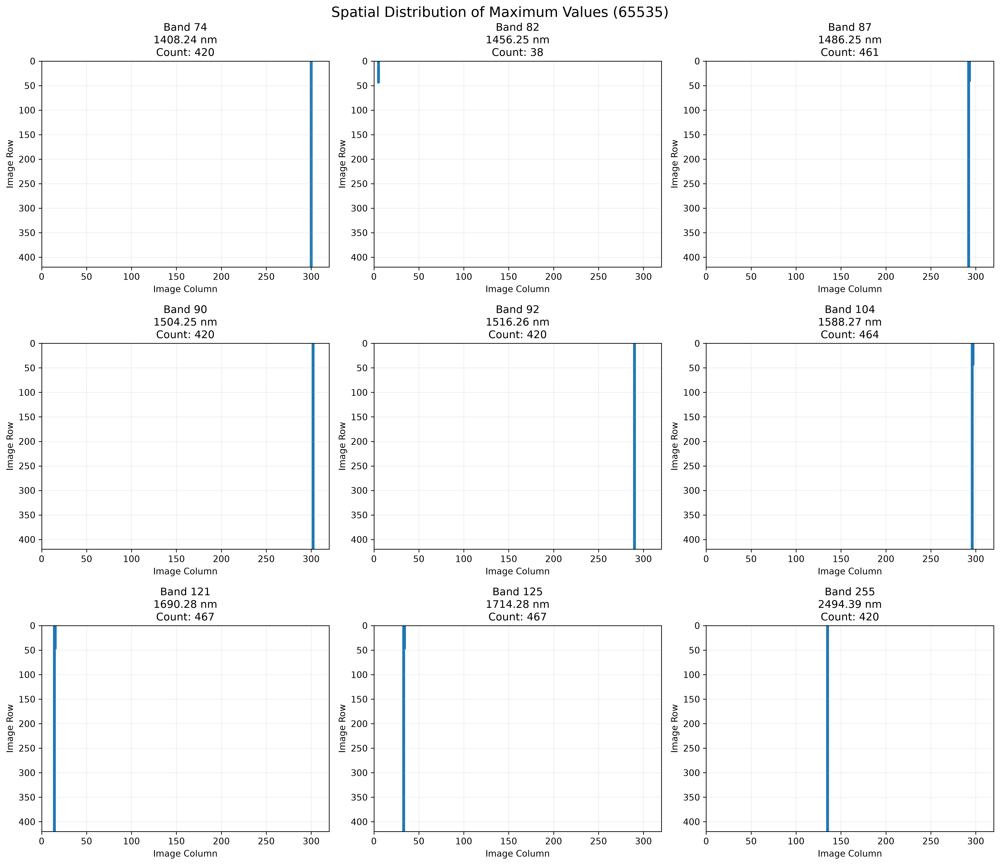
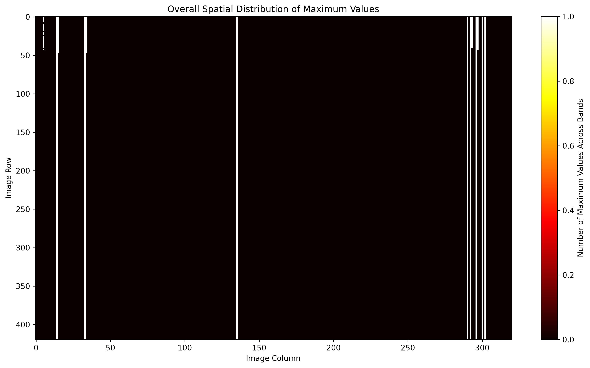
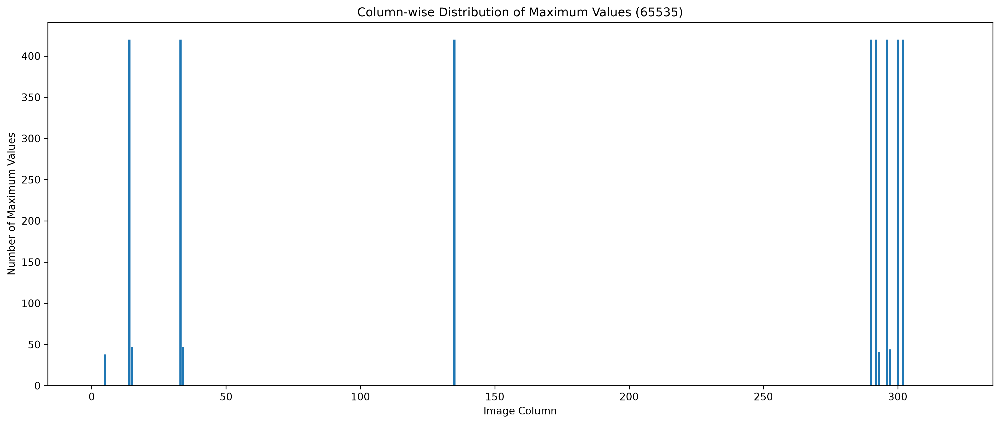
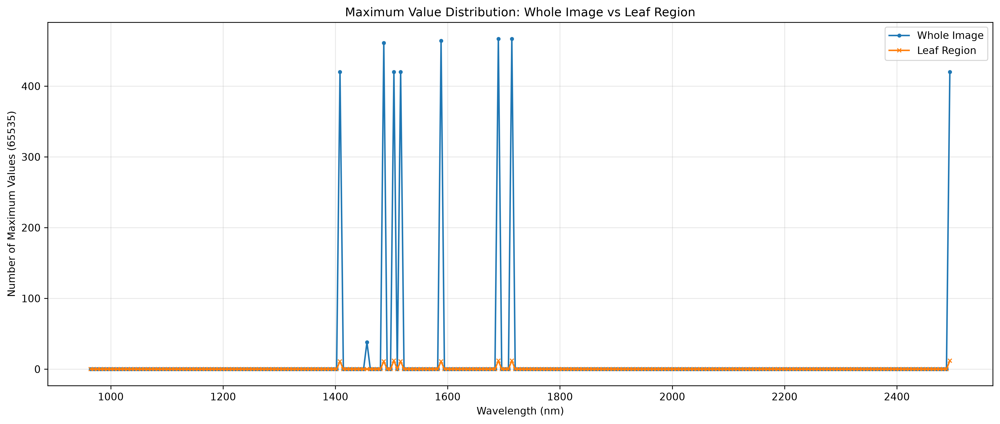
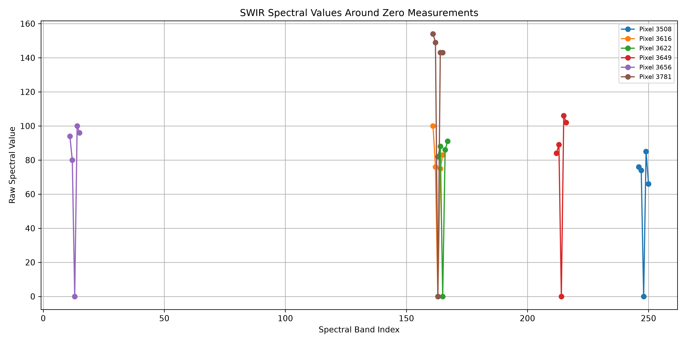
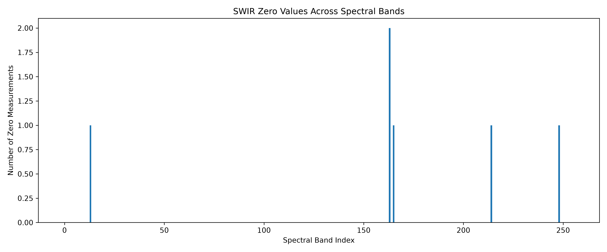
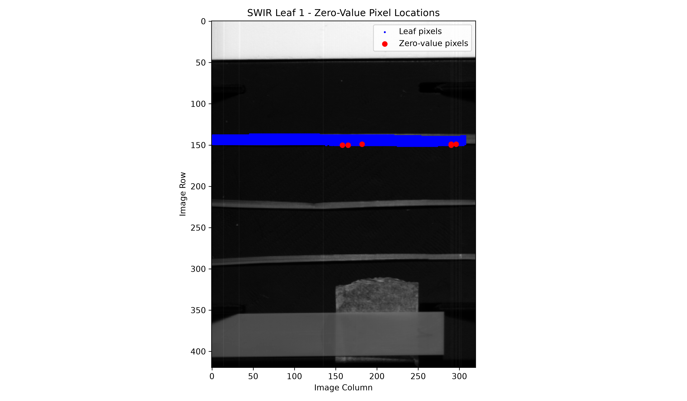

<div align="center">

# 🌱 TerraSpectra-AI

### Explainable Spectral Intelligence for Wheat Disease Detection

**Turning Hyperspectral Data into Explainable Agricultural Intelligence**

<br>


<br>

[📊 Dataset](#-dataset) · [🔬 Research](#-research-and-implementation) · [📈 Results](#-current-investigation-results) · [🛠 Technologies](#-technology-stack) · [🚀 Roadmap](#-project-roadmap)

</div>

---

## 🌍 About the Project

TerraSpectra-AI is an agricultural data science project that investigates hyperspectral imaging for wheat disease analysis.

It uses Visible-Near Infrared (VNIR) and Short-Wave Infrared (SWIR) data to explore spectral differences between infected and non-infected wheat leaf samples.

The project aims to combine:

- Hyperspectral Image Analysis
- Spectral Feature Investigation
- Important Wavelength Identification
- Machine Learning Classification
- Explainable Artificial Intelligence (XAI)

The goal is to develop a scientifically grounded and interpretable approach to wheat disease classification.

---

## 🎯 Project Highlights

| 🔍 Research Area | 💡 Project Focus |
|---|---|
| Hyperspectral Imaging | Analyse VNIR and SWIR measurements |
| Data Quality | Investigate unusual spectral values |
| Spectral Analysis | Explore wavelength-related patterns |
| Feature Identification | Identify informative wavelengths |
| Machine Learning | Classify infected and non-infected samples |
| Explainable AI | Understand model predictions |

---

## 🧭 Quick Navigation

<details open>

<summary><b>📚 Explore Project Documentation</b></summary>

- [Project Overview](#-about-the-project)
- [Problem Statement](#-problem-statement)
- [Objectives](#-research-objectives)
- [Dataset](#-dataset)
- [System Workflow](#-system-workflow)
- [Technology Stack](#-technology-stack)
- [Project Structure](#-project-structure)
- [Research and Implementation](#-research-and-implementation)
- [Current Investigation Results](#-current-investigation-results)
- [Visualization Gallery](#-visualization-gallery)
- [Project Roadmap](#-project-roadmap)
- [Installation](#-getting-started)
- [Limitations](#-research-limitations)

</details>

---

## ❗ Problem Statement

Traditional visual inspection may not reveal all spectral changes associated with plant disease.

Hyperspectral imaging provides measurements across multiple wavelengths, creating opportunities to investigate disease-related spectral patterns.

However, analysing this data requires careful handling of high-dimensional information, unusual pixel values, image coordinates, and model interpretability.

**TerraSpectra-AI investigates how hyperspectral analysis and explainable machine learning can help address these challenges.**

---

## 🎯 Research Objectives

- [x] Select a wheat disease hyperspectral dataset.
- [x] Inspect dataset metadata.
- [x] Prepare VNIR and SWIR annotation tables.
- [x] Inspect an actual SWIR hyperspectral image.
- [x] Investigate unusual maximum-value measurements.
- [x] Complete initial spatial maximum-value investigation.
- [x] Complete column-wise maximum-value investigation.
- [x] Complete initial SWIR spatial-neighbour investigation.
- [ ] Complete broader spatial quality validation.
- [ ] Extend processing to relevant samples.
- [ ] Identify important wavelengths.
- [ ] Develop disease classification models.
- [ ] Evaluate model performance.
- [ ] Apply Explainable AI techniques.

---

## 📊 Dataset

<details open>

<summary><b>Dataset Information</b></summary>

| Attribute | Details |
|---|---|
| Dataset | Early detection of Septoria infection on wheat leaves using hyperspectral imaging data |
| Repository | Recherche Data Gouv |
| DOI | `10.57745/WVP0FJ` |
| Crop | Wheat |
| Disease | Septoria |
| Modalities | VNIR and SWIR |
| Genotypes | EPO_67 and EPO_68 |
| Treatment groups | Infected and Non-infected |

**Dataset source:** [Open official dataset repository](https://entrepot.recherche.data.gouv.fr/dataset.xhtml?persistentId=doi:10.57745/WVP0FJ)

</details>

### 🔬 Inspected SWIR Sample

| Technical Specification | Value |
|---|---:|
| Image rows | 420 |
| Image columns | 320 |
| Spectral bands | 256 |
| Image dimensions | 420 × 320 × 256 |
| Wavelength range | 964.18–2494.39 nm |
| Source data type | uint16 |
| Interleave | BIL |
| Sensor | SWIR_320me_SN3518 |
| Acquisition date | 11 March 2021 |

These specifications describe the inspected SWIR sample, not the entire dataset.

### Prepared Sample Information

| Category | Count |
|---|---:|
| Total records per prepared dataset | 48 |
| Infected | 24 |
| Non-infected | 24 |
| EPO_67 genotype | 24 |
| EPO_68 genotype | 24 |

These are prepared annotation records, not individual spectral image pixels.

---

## ⚙ System Workflow



*The diagram represents the planned end-to-end workflow, not a claim that every stage is implemented.*

---

## 🛠 Technology Stack

| Technology | Application |
|---|---|
| 🐍 Python | Project implementation |
| 🔢 NumPy | Numerical computation |
| 🐼 Pandas | Dataset preparation |
| 📊 Matplotlib | Data visualization |
| 🔬 Spectral Python | Hyperspectral image inspection |
| 💻 VS Code | Development environment |
| 🌿 Git | Version control |
| 🐙 GitHub | Project hosting |

---

## 📂 Project Structure

<details>

<summary><b>Click to explore the project folders</b></summary>

```text
TerraSpectra-AI/
│
├── data/
│   ├── raw/
│   │   ├── Data_description.csv
│   │   ├── SWIR_data.csv
│   │   ├── VNIR_data.csv
│   │   └── SWIR_sample/
│   │
│   └── processed/
│       ├── SWIR_cleaned.csv
│       ├── SWIR_prepared.csv
│       ├── VNIR_cleaned.csv
│       ├── VNIR_prepared.csv
│       │
│       ├── SWIR_column_maximum_analysis.csv
│       ├── SWIR_maximum_value_comparison.csv
│       ├── SWIR_spatial_neighbour_analysis.csv
│       ├── SWIR_zero_neighbour_analysis.csv
│       ├── SWIR_zero_values_per_band.csv
│       ├── SWIR_zero_value_details.csv
│       │
│       ├── SWIR_spatial_maximum_distribution.png
│       ├── SWIR_overall_maximum_heatmap.png
│       ├── SWIR_column_maximum_distribution.png
│       ├── SWIR_maximum_value_locations.png
│       ├── SWIR_maximum_value_band_comparison.png
│       ├── SWIR_zero_neighbour_analysis.png
│       ├── SWIR_zero_values_per_band.png
│       ├── SWIR_zero_value_locations.png
│       ├── SWIR_coordinate_orientation_comparison.png
│       ├── SWIR_leaf1_coordinate_verification.png
│       └── SWIR_leaf_coordinate_check.png
│
├── main.py
├── inspect_raw.py
├── inspect_swir.py
├── investigate_swir_zero_values.py
├── investigate_swir_spatial_neighbours.py
├── README.md
└── .gitignore
```

</details>

*The structure represents the development workspace. Large raw files and ignored data may not be available in the GitHub repository.*

---

## 🔬 Research and Implementation

<details open>

<summary><b>Phase 1 — Dataset Inspection</b> ✅ Completed</summary>

- Inspected dataset metadata.
- Identified VNIR and SWIR data.
- Examined annotation information.
- Reviewed dataset organization.

</details>

<details open>

<summary><b>Phase 2 — Metadata Preparation</b> ✅ Completed</summary>

Prepared annotation tables for both imaging modalities.

| Treatment | Records |
|---|---:|
| Infected | 24 |
| Non-infected | 24 |
| Total | 48 |

These are pot-level annotation records, not individual spectral images.

</details>

<details open>

<summary><b>Phase 3 — SWIR Image Inspection</b> ✅ Completed</summary>

- Loaded an actual SWIR hyperspectral image.
- Inspected its dimensions and wavelength information.
- Examined leaf-coordinate information.
- Investigated measurements in the selected leaf region.
- Verified image indexing and coordinate orientation.

</details>

<details open>

<summary><b>Phase 4 — Spectral Quality Investigation</b> ✅ Initial Investigation Completed</summary>

Investigated:

- Zero-valued measurements.
- Maximum stored values.
- Affected spectral bands.
- Leaf-region measurements.
- Neighbouring wavelength values.

Further technical validation remains necessary.

</details>

<details open>

<summary><b>Phase 5 — Spatial Maximum-Value Investigation</b> ✅ Completed</summary>

Generated:

- Spatial maximum-value distribution.
- Overall maximum-value heatmap.
- Maximum-value location analysis.
- Band-wise spatial investigation.

</details>

<details open>

<summary><b>Phase 6 — Column-wise Maximum-Value Investigation</b> ✅ Completed</summary>

Investigated the distribution of maximum stored values (`65535`) across the 320 image columns.

Completed activities:

- Counted maximum-value occurrences across image columns.
- Identified columns with the highest counts.
- Generated a column-wise analysis CSV file.
- Created a column-wise maximum-value distribution graph.
- Examined the concentration of maximum-value occurrences.

**Generated outputs:**

- `SWIR_column_maximum_analysis.csv`
- `SWIR_column_maximum_distribution.png`

</details>

<details open>

<summary><b>Phase 7 — SWIR Spatial-Neighbour Investigation</b> ✅ Completed</summary>

Investigated the spatial neighbourhoods of six zero-valued measurements identified in the selected SWIR leaf-coordinate region.

**Completed activities:**

- Loaded the SWIR hyperspectral image using Spectral Python.
- Verified image dimensions of `420 × 320 × 256`.
- Validated BIL image indexing.
- Identified six target zero-valued measurements.
- Examined surrounding spatial pixels in eight directions at the same spectral band.
- Restricted neighbour analysis to pixels included in the leaf-coordinate mask.
- Recorded neighbouring measurements in a CSV file.

**Investigation results:**

| Measurement | Observed Result |
|---|---:|
| Target zero-valued measurements | 6 |
| Neighbour observations | 39 |
| Non-zero observations | 37 |
| Zero-valued observations | 2 |

The two zero-valued neighbour observations represent the same adjacent pixel pair, counted in opposite directions.

**Generated output:**

- `SWIR_spatial_neighbour_analysis.csv`

**Research note:** These findings describe the observed measurements only. The underlying cause of the zero values has not been established. No measurements have been removed or modified based on this investigation.

</details>

---
## Phase 8: VNIR & SWIR Prepared Dataset Validation

**Status: ✅ Completed**

Validated the prepared VNIR and SWIR datasets to check their structure, data quality, missing values, and sample distribution.

**Completed activities:**

- Loaded the VNIR and SWIR prepared datasets.
- Checked dataset dimensions and column information.
- Identified missing values.
- Checked duplicate rows and duplicate Pot IDs.
- Checked for infinite values.
- Examined treatment and genotype distributions.
- Identified completely empty measurement columns.
- Exported the validation summary to a CSV file.

**Dataset overview:**

| Attribute | VNIR | SWIR |
|---|---:|---:|
| Rows | 48 | 48 |
| Columns | 39 | 39 |
| Metadata columns | 3 | 3 |
| Measurement columns | 36 | 36 |
| Missing values | 553 | 553 |
| Duplicate rows | 0 | 0 |
| Duplicate Pot IDs | 0 | 0 |
| Infinite values | 0 | 0 |
| Completely empty columns | 3 | 3 |

**Treatment distribution:**

| Treatment | Records |
|---|---:|
| Infected | 24 |
| Non-infected | 24 |

**Genotype distribution:**

| Genotype | Records |
|---|---:|
| EPO_67 | 24 |
| EPO_68 | 24 |

**Completely empty measurement columns:**

- `DPI_18_D`
- `DPI_19_D`
- `DPI_20_D`

Each of these columns contains 48 missing values in both datasets.

**Generated files:**

- `validate_prepared_datasets.py`
- `data/processed/prepared_dataset_validation.csv`

**Research note:** Missing values and completely empty columns were documented during validation. No missing values were automatically imputed, and no columns were deleted or replaced with zeros.

**Outcome:** Initial structural and data-quality validation of both prepared datasets was completed successfully.

## 📈 Current Investigation Results

The inspected SWIR image contains:

| Measurement | Observed Result |
|---|---:|
| Total image values | 34,406,400 |
| Zero values | 527 |
| Maximum values (65,535) | 3,577 |
| NaN values | 0 |
| Infinite values | 0 |
| Leaf-coordinate pixels | 3,846 |
| Maximum values in leaf region | 92 |

### Affected Spectral Bands

| Band | Wavelength | Maximum Count |
|---:|---:|---:|
| 74 | 1408.24 nm | 11 |
| 87 | 1486.25 nm | 11 |
| 90 | 1504.25 nm | 12 |
| 92 | 1516.26 nm | 11 |
| 104 | 1588.27 nm | 11 |
| 121 | 1690.28 nm | 12 |
| 125 | 1714.28 nm | 12 |
| 255 | 2494.39 nm | 12 |

### Column-wise Maximum-Value Findings

The column-wise investigation identified eight columns with 420 maximum-value occurrences each.

| Image Column | Maximum-Value Count |
|---:|---:|
| 14 | 420 |
| 33 | 420 |
| 135 | 420 |
| 290 | 420 |
| 292 | 420 |
| 296 | 420 |
| 300 | 420 |
| 302 | 420 |

Other columns also contained smaller numbers of maximum-value occurrences.

**Research interpretation:** Maximum-value occurrences are concentrated in particular image columns rather than being evenly distributed. This suggests a spatial pattern that deserves further investigation.

The counts are calculated across all image rows and spectral bands. They do not establish the cause of the pattern.

**Research note:** The maximum stored values have not been confirmed as sensor saturation or invalid measurements. Their meaning requires further investigation. No spectral values have been deleted or modified.

### Zero-Value Spatial-Neighbour Findings

The spatial-neighbour investigation examined six zero-valued measurements in the selected leaf-coordinate region.

| Result | Count |
|---|---:|
| Target zero measurements | 6 |
| Neighbour observations | 39 |
| Non-zero neighbours | 37 |
| Zero-valued neighbours | 2 |

The two zero-valued neighbour observations are the same adjacent pixel pair recorded from opposite target directions.

The investigation does not establish why these zero values occur.

---

## 🖼 Visualization Gallery

<details open>

<summary><b>📍 SWIR Spatial Maximum-Value Distribution</b></summary>



</details>

<details open>

<summary><b>🌡 SWIR Overall Maximum-Value Heatmap</b></summary>



</details>

<details open>

<summary><b>📊 SWIR Column-wise Maximum-Value Distribution</b></summary>



</details>

<details>

<summary><b>Other Generated Visualizations</b></summary>

**Maximum-value locations**


**Maximum-value band comparison**



**Zero-value neighbour analysis**



**Zero values per spectral band**



**Zero-value locations**



</details>

---

## 🚀 Project Roadmap

| Development Stage | Status |
|---|---|
| Dataset collection | 🟢 Completed for current working data |
| Metadata preparation | 🟢 Completed |
| SWIR image inspection | 🟢 Completed for one sample |
| Initial quality investigation | 🟢 Completed |
| Spatial maximum analysis | 🟢 Completed |
| Column-wise investigation | 🟢 Completed |
| Initial spatial-neighbour investigation | 🟢 Completed |
| Broader spatial quality validation | 🟡 In Progress |
| Full spectral preprocessing | ⚪ Planned |
| Wavelength identification | ⚪ Planned |
| Disease classification | ⚪ Planned |
| Explainable AI | ⚪ Planned |
| Model evaluation | ⚪ Planned |

**Legend:** 🟢 Completed · 🟡 In Progress · ⚪ Planned

---

## 💻 Getting Started

### 1. Clone the repository

```bash
git clone https://github.com/sanjanamdinfo/TerraSpectra-AI.git
```

### 2. Open project directory

```bash
cd TerraSpectra-AI
```

### 3. Create a virtual environment

```bash
python -m venv venv
```

### 4. Activate the environment

**Windows PowerShell:**

```powershell
.\venv\Scripts\Activate.ps1
```

### 5. Install dependencies

```bash
pip install numpy pandas matplotlib spectral
```

### 6. Execute metadata preparation

```bash
python main.py
```

### 7. Inspect raw dataset information

```bash
python inspect_raw.py
```

### 8. Run SWIR image inspection

```bash
python inspect_swir.py
```

**Note:** The SWIR inspection scripts require the corresponding local `.hdr`, `.hyspex`, and leaf-coordinate files. These raw sample files may not be included in the repository.

---

## ⚠ Research Limitations

- Current image-level findings are based on one inspected SWIR sample.
- The maximum stored values require technical validation.
- The cause of zero-valued measurements remains unknown.
- Coordinate orientation and mapping require continued validation.
- Full-dataset spectral preprocessing is not yet completed.
- Disease classification and model performance have not yet been established.
- Early detection claims require suitable time-linked experimental validation.

---

## 🔮 Future Enhancements

- Complete spatial quality validation.
- Validate coordinate mapping.
- Expand SWIR and VNIR processing.
- Identify disease-related spectral patterns.
- Select informative wavelengths.
- Train machine learning models.
- Apply SHAP or other appropriate explainability methods.
- Compare full-spectrum and selected-wavelength models.
- Build an interactive results dashboard.

---
## Phase 9: VNIR & SWIR Data Acquisition Completeness Analysis

**Status: ✅ Completed**

Performed an acquisition completeness analysis using the VNIR and SWIR annotation tables to understand leaf acquisition patterns across observation dates, pot sides, treatment groups, and genotypes.

### Completed activities

- Loaded and inspected the SWIR and VNIR acquisition annotation files.
- Identified 48 pot records across 18 observation dates.
- Counted recorded leaves for both pot sides (G and D).
- Identified empty cells representing no HSI acquisition due to sampling.
- Identified `NA` entries representing technical malfunctions.
- Compared acquisition patterns between VNIR and SWIR.
- Examined acquisition records by treatment and genotype.
- Validated group-level totals against overall sensor summaries.

### Acquisition completeness results

| Attribute | VNIR | SWIR |
|---|---:|---:|
| Pot records | 48 | 48 |
| Observation dates | 18 | 18 |
| Expected date-side entries | 1,728 | 1,728 |
| Numeric entries | 1,175 | 1,175 |
| Empty cells | 552 | 552 |
| Technical NA entries | 1 | 1 |
| Unexpected values | 0 | 0 |

### Acquisition groups

The analysis covered four treatment-genotype combinations:

- Infected — EPO_67
- Infected — EPO_68
- Non-infected — EPO_67
- Non-infected — EPO_68

Each group contains 12 pot records.

### Key observations

- Acquisition coverage varies across observation dates and pot sides.
- The number of recorded leaves decreases at several later observation dates.
- The D side has no recorded leaf acquisitions at DPI 18, 19, and 20.
- The G side continues to have recorded acquisitions at these dates.
- VNIR and SWIR show very similar acquisition patterns, with small differences in recorded leaf counts at DPI 4.
- Each sensor annotation table contains one technical `NA` entry at DPI 10 on the G side.

### Generated files

- `analyze_acquisition_completeness.py`
- `data/processed/acquisition_completeness_summary.csv`
- `data/processed/acquisition_completeness_by_group.csv`

### Validation

The group-level results were compared with the overall sensor summaries.

**Validation results:**

| Validation check | Result |
|---|---|
| Group totals match overall totals | True |
| Treatment-genotype combinations | 4 |
| Sensors analysed | 2 |
| Unexpected values | 0 |

**Research note:** Empty cells and technical `NA` values were treated as separate categories according to the dataset documentation. Empty cells indicate no HSI acquisition due to sampling, whereas `NA` indicates a technical malfunction. No missing entries were automatically filled or removed.

**Outcome:** VNIR and SWIR acquisition completeness analysis and group-level validation were successfully completed. This analysis describes the acquisition annotation records, not the quality of individual hyperspectral image pixels.

<div align="center">

## 🌱 Our Vision

**From hyperspectral measurements to interpretable agricultural intelligence.**

Building TerraSpectra-AI step by step with reliable data, transparent analysis, and explainable results.

<br>

⭐ If you find this project interesting, consider starring the repository!

[](https://github.com/sanjanamdinfo/TerraSpectra-AI)

</div>