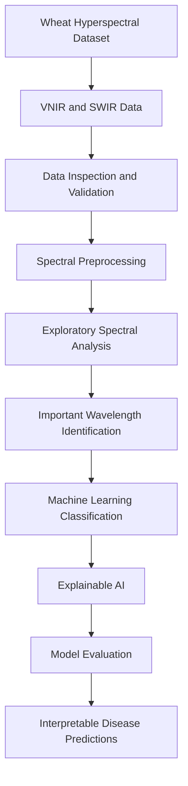
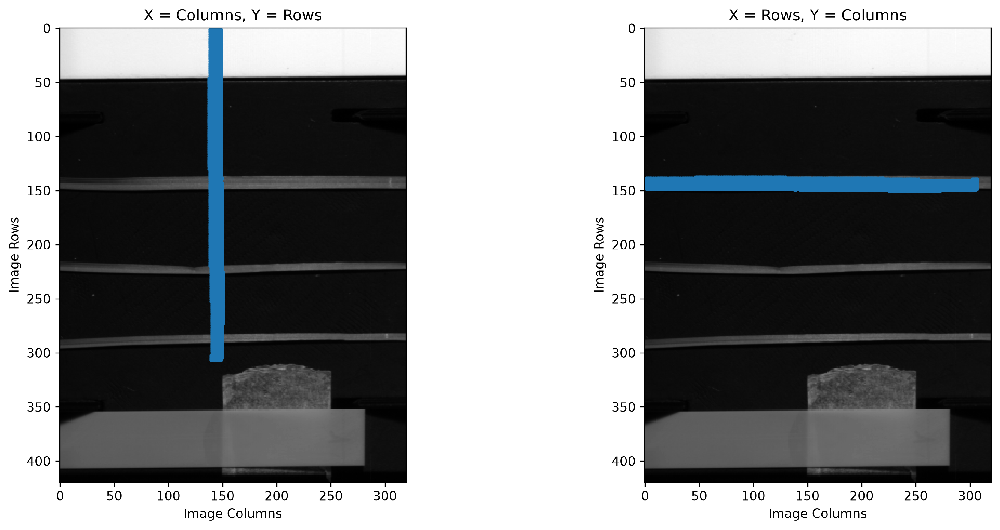

# 🌱 TerraSpectra-AI
### Explainable Spectral Intelligence for Wheat Disease Detection

<p align="center">
  <strong>Understanding Wheat Disease Through Hyperspectral Imaging and Explainable Artificial Intelligence</strong>
</p>

---

## 📌 Table of Contents

- [Overview](#-project-overview)
- [Problem Statement](#-problem-statement)
- [Objectives](#-project-objectives)
- [Key Features](#-key-features)
- [Dataset](#-dataset-information)
- [System Workflow](#-system-workflow)
- [Current Progress](#-project-progress)
- [Visual Results](#-visual-results)
- [Technologies](#-technologies-used)
- [Project Structure](#-project-structure)
- [Installation](#-installation-and-setup)
- [Roadmap](#-future-roadmap)

---

## 🌾 Project Overview

**TerraSpectra-AI** is an individual academic project focused on developing an explainable artificial intelligence system for wheat disease detection using hyperspectral imaging.

The project investigates Visible-Near Infrared (VNIR) and Short-Wave Infrared (SWIR) spectral information collected from wheat leaves to distinguish infected and non-infected samples.

Unlike conventional image classification approaches, hyperspectral imaging captures information across multiple wavelength bands.

The project aims to identify informative wavelengths associated with disease classification and develop interpretable machine learning models.

### 🎯 Main Idea

**From spectral information → Important wavelength identification → Disease classification → Explainable predictions.**

---

## ⚠️ Problem Statement

Wheat diseases can negatively affect crop health and agricultural productivity.

Traditional disease identification methods often depend on visible symptoms and manual inspection.

Hyperspectral imaging provides additional spectral information that may help distinguish healthy and infected plant samples.

However, identifying the most informative wavelengths and understanding how machine learning models make predictions remain important challenges.

TerraSpectra-AI explores these challenges through spectral analysis, machine learning and explainable AI.

---

## 🎯 Project Objectives

1. Collect and inspect wheat hyperspectral imaging data.
2. Prepare and validate VNIR and SWIR spectral datasets.
3. Analyse spectral characteristics of infected and non-infected samples.
4. Identify important wavelengths for disease classification.
5. Develop machine learning models for wheat disease detection.
6. Apply Explainable AI techniques to understand model predictions.
7. Compare classification performance using full-spectrum and selected-wavelength features.

---

## ✨ Key Features

| Feature | Description |
|---|---|
| 🌱 Hyperspectral Analysis | Analyse VNIR and SWIR information. |
| 🧹 Data Preprocessing | Inspect, validate and prepare spectral data. |
| 🔬 Spectral Analysis | Study wavelength-related patterns. |
| 🎯 Wavelength Selection | Identify informative spectral bands. |
| 🤖 Disease Classification | Develop infected/non-infected classification models. |
| 🧠 Explainable AI | Interpret model predictions. |
| 📊 Model Evaluation | Evaluate and compare model performance. |

*Features are being developed progressively. See the project progress section for implementation status.*

---

## 🧬 Dataset Information

### Dataset Name

**Early detection of Septoria infection on wheat leaves using hyperspectral imaging data**

- Repository: Recherche Data Gouv
- DOI: `10.57745/WVP0FJ`
- Data modalities: VNIR and SWIR hyperspectral imaging
- Sample information: Wheat genotype, treatment, leaf and measurement dates.
- Classes: Infected and Non-infected.

### Spectral Data Modalities

| Data Type | Description |
|---|---|
| VNIR | Visible-Near Infrared spectral imaging |
| SWIR | Short-Wave Infrared spectral imaging |

### Dataset Metadata

The dataset includes information such as:

- Pot identification
- Leaf identification
- Genotype
- Treatment
- Confidence level
- Measurement dates

**Important:** The dataset contains controlled hyperspectral wheat-leaf measurements, not satellite imagery.

---

## 🔄 System Workflow

The planned system follows this workflow:



---

## 📊 Project Progress

Project development is ongoing.

| Development Stage | Status |
|---|---|
| Project setup and GitHub repository | ✅ Completed |
| Dataset collection | ✅ Completed |
| Raw and processed data organisation | ✅ Completed |
| Initial metadata inspection | ✅ Completed |
| Basic metadata EDA | ✅ Completed |
| SWIR image inspection | ✅ Completed for one sample |
| Leaf-coordinate inspection | ✅ Completed for one sample |
| Leaf spectral extraction | ✅ Completed for one sample |
| Initial spectral quality investigation | 🔄 In progress |
| Complete spectral preprocessing | ⏳ Pending |
| VNIR/SWIR spectral analysis | ⏳ Pending |
| Important wavelength identification | ⏳ Pending |
| Disease classification | ⏳ Pending |
| Explainable AI implementation | ⏳ Pending |
| Model evaluation | ⏳ Pending |

---

## 🖼️ Visual Results

### 1. SWIR Leaf Coordinate Inspection

This visualisation compares the leaf-coordinate mapping against the hyperspectral image.



### 2. Maximum Spectral Value Locations

This plot displays the spatial locations of maximum-value measurements identified during the initial SWIR spectral quality investigation.


<details>
<summary>📌 View initial SWIR inspection findings</summary>

- Image dimensions: 420 × 320 × 256
- Wavelength range: 964.18–2494.39 nm
- Extracted leaf pixels: 3,846
- Wavelength bands: 256
- Extracted measurements: 984,576
- Maximum-value measurements: 92
- Affected wavelength bands: 8

The maximum-value measurements are still under investigation. They have not been automatically removed or classified as invalid.

</details>

---

## 🛠️ Technologies Used

| Technology | Purpose |
|---|---|
| Python | Main programming language |
| NumPy | Numerical operations |
| Pandas | Dataset processing |
| Matplotlib | Data visualisation |
| Spectral Python | Hyperspectral image inspection |
| VS Code | Development environment |
| Git | Version control |
| GitHub | Project repository |

---

## 📂 Project Structure

```text
TerraSpectra-AI/
│
├── data/
│   ├── raw/
│   │   ├── Data_description.csv
│   │   ├── SWIR_data.csv
│   │   ├── VNIR_data.csv
│   │   └── SWIR_sample/
│   │
│   └── processed/
│       ├── SWIR_cleaned.csv
│       ├── SWIR_prepared.csv
│       ├── VNIR_cleaned.csv
│       ├── VNIR_prepared.csv
│       ├── SWIR_leaf_coordinate_check.png
│       └── SWIR_maximum_value_locations.png
│
├── main.py
├── inspect_raw.py
├── inspect_swir.py
├── .gitignore
└── README.md
```

*The SWIR sample folder contains local raw image files and is not included in the GitHub commit.*

---

## 🚀 Installation and Setup

### Step 1: Clone the repository

```bash
git clone https://github.com/sanjanamdinfo/TerraSpectra-AI.git
```

### Step 2: Open the project

```bash
cd TerraSpectra-AI
```

### Step 3: Install required libraries

```bash
python -m pip install numpy pandas matplotlib spectral
```

### Step 4: Run the metadata inspection and preparation script

```bash
python main.py
```

### Step 5: Inspect the SWIR sample

After placing the required local SWIR sample files in the expected folder, run:

```bash
python inspect_swir.py
```

---

## 🗺️ Future Roadmap

<details>
<summary>🔬 Phase 1 – Spectral Data Preparation</summary>

- [x] Dataset selection
- [x] Initial data organisation
- [x] SWIR sample inspection
- [x] Leaf-coordinate validation
- [ ] Complete SWIR preprocessing
- [ ] VNIR spectral image inspection
- [ ] Validate preprocessing across samples

</details>

<details>
<summary>📊 Phase 2 – Spectral Analysis</summary>

- [ ] Analyse spectral signatures
- [ ] Compare infected and non-infected samples
- [ ] Identify informative wavelengths
- [ ] Perform wavelength selection

</details>

<details>
<summary>🤖 Phase 3 – Machine Learning</summary>

- [ ] Prepare model-ready features
- [ ] Train classification models
- [ ] Compare model performance
- [ ] Evaluate classification results

</details>

<details>
<summary>🧠 Phase 4 – Explainable AI</summary>

- [ ] Integrate SHAP or suitable explainability methods
- [ ] Interpret important spectral features
- [ ] Explain individual predictions
- [ ] Compare explanations across disease classes

</details>

---

## 🌟 Expected Outcome

The expected outcome is an explainable spectral intelligence system that:

- Analyses hyperspectral wheat-leaf measurements.
- Distinguishes infected and non-infected samples.
- Identifies informative wavelengths.
- Provides interpretable machine learning predictions.
- Supports understanding of spectral patterns associated with wheat disease.

---

## 👩‍💻 Project Information

**Project:** TerraSpectra-AI  
**Focus:** Explainable AI and Hyperspectral Image Analysis  
**Application:** Wheat Disease Detection  
**Project Type:** Individual Academic Project

---

<p align="center">
  <strong>🌱 Exploring Spectral Intelligence for Smarter Agriculture 🌱</strong>
</p>

<p align="center">
  <sub>Built with Python, Machine Learning and Explainable AI.</sub>
</p>