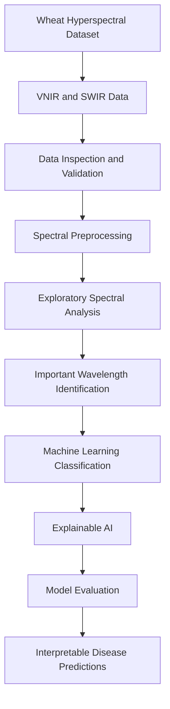
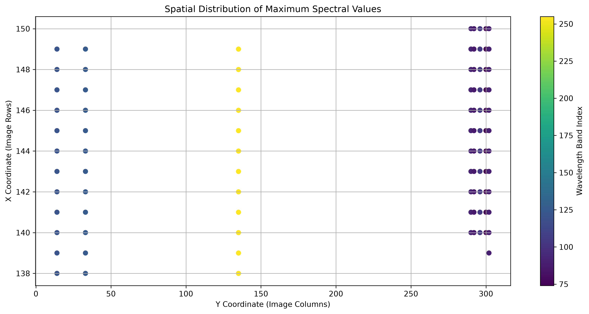

# 🌱 TerraSpectra-AI
### Explainable Spectral Intelligence for Wheat Disease Detection

<p align="center">
  <strong>Understanding Wheat Disease Through Hyperspectral Imaging and Explainable Artificial Intelligence</strong>
</p>

---

## 📌 Table of Contents

- [Project Overview](#-project-overview)
- [Problem Statement](#-problem-statement)
- [Project Objectives](#-project-objectives)
- [Key Features](#-key-features)
- [Dataset Information](#-dataset-information)
- [System Workflow](#-system-workflow)
- [Project Progress](#-project-progress)
- [SWIR Sample Quality Validation](#-swir-sample-quality-validation)
- [Prepared Dataset Validation](#-prepared-dataset-validation)
- [VNIR and SWIR Cross-Sensor Validation](#-vnir-and-swir-cross-sensor-validation)
- [Visual Results](#-visual-results)
- [Technologies Used](#-technologies-used)
- [Project Structure](#-project-structure)
- [Installation and Setup](#-installation-and-setup)
- [Future Roadmap](#-future-roadmap)
- [Expected Outcome](#-expected-outcome)
- [Project Information](#-project-information)

---

## 🌾 Project Overview

**TerraSpectra-AI** is an individual academic project focused on developing an explainable artificial intelligence system for wheat disease detection using hyperspectral imaging.

The project investigates Visible-Near Infrared (VNIR) and Short-Wave Infrared (SWIR) spectral information collected from wheat leaves to distinguish infected and non-infected samples.

Unlike conventional image classification approaches, hyperspectral imaging captures information across multiple wavelength bands.

The project aims to identify informative wavelengths associated with disease classification and develop interpretable machine learning models.

### 🎯 Main Idea

**Spectral Information → Important Wavelength Identification → Disease Classification → Explainable Predictions**

---

## ⚠️ Problem Statement

Wheat diseases can negatively affect crop health and agricultural productivity.

Traditional disease identification methods often depend on visible symptoms and manual inspection.

Hyperspectral imaging provides additional spectral information that may help distinguish healthy and infected plant samples.

However, identifying the most informative wavelengths and understanding how machine learning models make predictions remain important challenges.

TerraSpectra-AI explores these challenges through spectral analysis, machine learning and explainable AI.

---

## 🎯 Project Objectives

1. Collect and inspect wheat hyperspectral imaging data.
2. Prepare and validate VNIR and SWIR spectral datasets.
3. Analyse spectral characteristics of infected and non-infected samples.
4. Identify important wavelengths for disease classification.
5. Develop machine learning models for wheat disease detection.
6. Apply Explainable AI techniques to understand model predictions.
7. Compare classification performance using full-spectrum and selected-wavelength features.

---

## ✨ Key Features

| Feature | Description |
|---|---|
| 🌱 Hyperspectral Analysis | Analyse VNIR and SWIR information. |
| 🧹 Data Preprocessing | Inspect, validate and prepare spectral data. |
| 🔬 Spectral Quality Validation | Investigate spectral measurements and zero values. |
| 🎯 Wavelength Selection | Identify informative spectral bands. |
| 🤖 Disease Classification | Develop infected/non-infected classification models. |
| 🧠 Explainable AI | Interpret model predictions. |
| 📊 Model Evaluation | Evaluate and compare model performance. |

*Features are being developed progressively. See the project progress section for implementation status.*

---

## 🧬 Dataset Information

### Dataset Name

**Early detection of Septoria infection on wheat leaves using hyperspectral imaging data**

- Repository: Recherche Data Gouv
- DOI: `10.57745/WVP0FJ`
- Data modalities: VNIR and SWIR hyperspectral imaging
- Sample information: Wheat genotype, treatment, leaf and measurement dates.
- Classes: Infected and Non-infected.

### Spectral Data Modalities

| Data Type | Description |
|---|---|
| VNIR | Visible-Near Infrared spectral imaging |
| SWIR | Short-Wave Infrared spectral imaging |

### Dataset Metadata

The dataset includes information such as:

- Pot identification
- Leaf identification
- Genotype
- Treatment
- Confidence level
- Measurement dates

**Important:** The dataset contains controlled hyperspectral wheat-leaf measurements, not satellite imagery.

---

## 🔄 System Workflow

The planned system follows this workflow:



---

## 📊 Project Progress

Project development is ongoing.

| Development Stage | Status |
|---|---|
| Project setup and GitHub repository | ✅ Completed |
| Dataset collection | ✅ Completed |
| Raw and processed data organisation | ✅ Completed |
| Initial metadata inspection | ✅ Completed |
| Basic metadata EDA | ✅ Completed |
| SWIR image inspection | ✅ Completed for one sample |
| Leaf-coordinate inspection | ✅ Completed |
| Leaf spectral extraction | ✅ Completed for one sample |
| SWIR zero-value quality validation | ✅ Completed for one sample |
| VNIR/SWIR prepared metadata validation | ✅ Completed |
| VNIR/SWIR cross-sensor acquisition investigation | ✅ Completed |
| Cleaned-to-prepared exact content validation | ✅ Completed |
| Complete spectral quality investigation | 🔄 In progress |
| Complete spectral preprocessing | ⏳ Pending |
| VNIR/SWIR spectral analysis | ⏳ Pending |
| Important wavelength identification | ⏳ Pending |
| Disease classification | ⏳ Pending |
| Explainable AI implementation | ⏳ Pending |
| Model evaluation | ⏳ Pending |

---

## 🔬 SWIR Sample Quality Validation

On **20 November 2026**, an additional quality validation investigation was performed on one SWIR hyperspectral sample.

### 1. Sample Information

| Parameter | Details |
|---|---|
| Sample | `01_D` |
| Acquisition Date | 11 March 2021 |
| Image Dimensions | 420 × 320 × 256 |
| Interleave | BIL |
| Data Type | Unsigned 16-bit integer |
| Spectral Bands | 256 |
| Wavelength Range | Approximately 964.18–2494.38 nm |
| Leaf Coordinates | 3,846 |

### 2. Spectral Measurement Validation

The extracted leaf region was checked across all 256 spectral bands.

| Validation Metric | Result |
|---|---:|
| Total Leaf Pixels | 3,846 |
| Total Spectral Bands | 256 |
| Total Measurements | 984,576 |
| Zero Measurements | 6 |
| Bands Containing Zero Values | 5 |
| ENVI Ignore-Value Measurements (16383) | 0 |
| Zero Measurement Rate | Approximately 0.00061% |

### 3. Zero-Value Band Details

Six zero measurements were identified across five spectral bands.

| Spectral Band | Number of Zero Measurements |
|---|---:|
| 13 | 1 |
| 163 | 2 |
| 165 | 1 |
| 214 | 1 |
| 248 | 1 |
| **Total** | **6** |

### 4. Validation Activities

The investigation included:

- Verification of hyperspectral image indexing.
- Validation of leaf-coordinate membership.
- Identification of zero-valued spectral measurements.
- Comparison with neighbouring pixel measurements.
- Leaf-specific neighbourhood analysis.
- Quality analysis across all 256 spectral bands.
- Verification of ENVI ignore-value measurements.

### 5. Findings

- All six identified zero measurements belong to the selected leaf-coordinate region.
- The six zero measurements are sparse compared with the total number of measurements.
- No ENVI ignore-value measurements were identified in the selected leaf region.
- The original hyperspectral data was not modified.
- The physical cause of the zero measurements has not yet been established.

**Note:** These findings apply to the investigated SWIR sample only. Further validation is required before drawing conclusions about other samples.

---
---

## 📊 Prepared Dataset Validation

On **21 November 2026**, the prepared VNIR and SWIR metadata datasets were validated using the existing `validate_prepared_datasets.py` script.

### 1. Dataset Validation Results

| Validation Metric | VNIR | SWIR |
|---|---:|---:|
| Samples | 48 | 48 |
| Columns | 39 | 39 |
| Missing Values | 553 | 553 |
| Duplicate Rows | 0 | 0 |
| Duplicate Pot IDs | 0 | 0 |
| Infinite Values | 0 | 0 |
| Completely Empty Columns | 3 | 3 |

### 2. Sample Distribution

Both datasets have the following distribution:

| Genotype | Infected | Non-infected |
|---|---:|---:|
| EPO_67 | 12 | 12 |
| EPO_68 | 12 | 12 |
| **Total** | **24** | **24** |

### 3. Missing Acquisition Information

Three acquisition columns contain no recorded values:

- `DPI_18_D`
- `DPI_19_D`
- `DPI_20_D`

Both datasets contain 553 missing acquisition values.

These missing values require interpretation using the original acquisition records. They have not been automatically replaced or removed.

### 4. Validation Activities

- Checked dataset dimensions.
- Inspected missing values.
- Checked duplicate records and Pot IDs.
- Verified treatment distribution.
- Verified genotype distribution.
- Checked infinite values.
- Identified completely empty columns.

### 5. Validation Report

The validation script generates:

`data/processed/prepared_dataset_validation.csv`

**Note:** This validation covers prepared metadata tables. It does not represent completed VNIR/SWIR spectral image preprocessing or spectral analysis.

---

## 🔍 VNIR and SWIR Cross-Sensor Validation

**Investigation Date: 23 November 2026**

A detailed investigation was performed to compare the prepared VNIR and SWIR datasets and verify that the preprocessing pipeline correctly preserves the cleaned source data.

### 1. Prepared Dataset Comparison

| Validation Metric | VNIR | SWIR |
|---|---:|---:|
| Pot Records | 48 | 48 |
| Columns | 39 | 39 |
| Duplicate Pot IDs | 0 | 0 |
| Missing Values | 553 | 553 |

Both datasets contain the same Pot IDs, genotype information and treatment labels.

### 2. Cross-Sensor Acquisition Differences

A total of 12 acquisition-count cells differed between VNIR and SWIR.

The differences were identified in the following pots:

- Pot 13
- Pot 20
- Pot 23
- Pot 25
- Pot 47

The investigation identified:
- 10 numerical acquisition-count differences.
- 2 different missing-value positions.

These differences were checked against the original raw VNIR and SWIR datasets. All 12 differences were already present in the original source records.

### 3. Technical Malfunction Records

The following missing measurements were verified:

| Dataset | Pot | DPI | Side |
|---|---:|---:|---|
| VNIR | 47 | 10 | G |
| SWIR | 23 | 10 | G |

These records correspond to the previously identified technical-malfunction entries.

### 4. Cleaned-to-Prepared Dataset Validation

The preparation filtering was reproduced and the expected datasets were compared with the saved prepared datasets.

| Validation Check | VNIR | SWIR |
|---|---|---|
| Dataset Shape | ✅ Pass | ✅ Pass |
| Column Names | ✅ Pass | ✅ Pass |
| Pot IDs | ✅ Pass | ✅ Pass |
| Genotype | ✅ Pass | ✅ Pass |
| Treatment | ✅ Pass | ✅ Pass |
| Acquisition Counts | ✅ Pass | ✅ Pass |
| Missing-Value Patterns | ✅ Pass | ✅ Pass |
| Exact Content Match | ✅ Pass | ✅ Pass |

Both datasets matched their corresponding cleaned datasets exactly after normalizing Pot IDs.

### 5. Conclusion

The investigation confirmed that the prepared VNIR and SWIR datasets correctly preserve their corresponding cleaned datasets.

The differences between the two sensors originated in the original raw acquisition records and were not introduced by the preparation pipeline.

No changes to the original datasets or preprocessing code were required during this investigation.

**Note:** This validation concerns acquisition-count metadata. It does not represent completed spectral image preprocessing or spectral analysis.
## 🖼️ Visual Results

### 1. SWIR Leaf Coordinate Inspection

This visualisation compares the leaf-coordinate mapping against the hyperspectral image.


### 2. Maximum Spectral Value Locations

This plot displays the spatial locations of maximum-value measurements identified during the initial SWIR spectral quality investigation.



<details>
<summary>📌 View initial SWIR inspection findings</summary>

- Image dimensions: 420 × 320 × 256
- Wavelength range: 964.18–2494.39 nm
- Extracted leaf pixels: 3,846
- Wavelength bands: 256
- Extracted measurements: 984,576
- Maximum-value measurements: 92
- Affected wavelength bands: 8

The maximum-value measurements are still under investigation. They have not been automatically removed or classified as invalid.

</details>

---

## 🛠️ Technologies Used

| Technology | Purpose |
|---|---|
| Python | Main programming language |
| NumPy | Numerical operations |
| Pandas | Dataset processing |
| Matplotlib | Data visualisation |
| Spectral Python | Hyperspectral image inspection |
| VS Code | Development environment |
| Git | Version control |
| GitHub | Project repository |

---

## 📂 Project Structure

```text
TerraSpectra-AI/
│
├── data/
│   ├── raw/
│   │   ├── Data_description.csv
│   │   ├── SWIR_data.csv
│   │   ├── VNIR_data.csv
│   │   └── SWIR_sample/          # Local raw sample; Git-ignored
│   │
│   └── processed/
│       ├── SWIR_cleaned.csv
│       ├── SWIR_prepared.csv
│       ├── VNIR_cleaned.csv
│       ├── VNIR_prepared.csv
│       ├── SWIR_leaf_coordinate_check.png
│       └── SWIR_maximum_value_locations.png
│
├── main.py
├── inspect_raw.py
├── inspect_swir.py
├── analyze_acquisition_completeness.py
├── investigate_swir_spatial_neighbours.py
├── investigate_swir_zero_values.py
├── analyze_all_swir_bands.py
├── analyze_leaf_band_quality.py
├── analyze_zero_neighbours.py
├── check_swir_indexing.py
├── validate_swir_coordinates.py
│
├── validate_prepared_datasets.py
├── verify_coordinates.py
├── verify_leaf_coordinates.py
├── .gitignore
└── README.md
```

**Dataset note:** The local `data/raw/SWIR_sample/` folder is excluded from GitHub because it contains large raw hyperspectral files. The sample files must be obtained separately to run the corresponding SWIR validation scripts.

---

## 🚀 Installation and Setup

### Step 1: Clone the repository

```bash
git clone https://github.com/sanjanamdinfo/TerraSpectra-AI.git
```

### Step 2: Open the project

```bash
cd TerraSpectra-AI
```

### Step 3: Install required libraries

```bash
python -m pip install numpy pandas matplotlib spectral
```

### Step 4: Run the metadata inspection and preparation script

```bash
python main.py
```

### Step 5: Inspect the SWIR sample

After placing the required local SWIR sample files in the expected folder, run:

```bash
python inspect_swir.py
```

### Step 6: Run SWIR quality validation

```bash
python analyze_all_swir_bands.py
```

Additional validation scripts:

```bash
python check_swir_indexing.py
python validate_swir_coordinates.py
python analyze_zero_neighbours.py
python analyze_leaf_band_quality.py
```

---

## 🗺️ Future Roadmap

<details>
<summary>🔬 Phase 1 – Spectral Data Preparation</summary>

- [x] Dataset selection
- [x] Initial data organisation
- [x] SWIR sample inspection
- [x] Leaf-coordinate validation
- [x] Initial SWIR zero-value validation
- [x] VNIR and SWIR prepared dataset comparison
- [x] Cross-sensor acquisition-count difference investigation
- [x] Verification of acquisition-count differences against raw datasets
- [x] Validation of matching acquisition dates and G/D side columns
- [ ] Complete SWIR preprocessing
- [ ] VNIR spectral image inspection
- [ ] Validate preprocessing across samples

</details>

<details>
<summary>📊 Phase 2 – Spectral Analysis</summary>

- [ ] Analyse spectral signatures
- [ ] Compare infected and non-infected samples
- [ ] Identify informative wavelengths
- [ ] Perform wavelength selection

</details>

<details>
<summary>🤖 Phase 3 – Machine Learning</summary>

- [ ] Prepare model-ready features
- [ ] Train classification models
- [ ] Compare model performance
- [ ] Evaluate classification results

</details>

<details>
<summary>🧠 Phase 4 – Explainable AI</summary>

- [ ] Integrate SHAP or suitable explainability methods
- [ ] Interpret important spectral features
- [ ] Explain individual predictions
- [ ] Compare explanations across disease classes

</details>

---

## 🌟 Expected Outcome

The expected outcome is an explainable spectral intelligence system that:

- Analyses hyperspectral wheat-leaf measurements.
- Distinguishes infected and non-infected samples.
- Identifies informative wavelengths.
- Provides interpretable machine learning predictions.
- Supports understanding of spectral patterns associated with wheat disease.

---

## 👩‍💻 Project Information

**Project:** TerraSpectra-AI  
**Focus:** Explainable AI and Hyperspectral Image Analysis  
**Application:** Wheat Disease Detection  
**Project Type:** Individual Academic Project  

---

<p align="center">
  <strong>🌱 Exploring Spectral Intelligence for Smarter Agriculture 🌱</strong>
</p>

<p align="center">
  <sub>Built with Python, Machine Learning and Explainable AI.</sub>
</p>