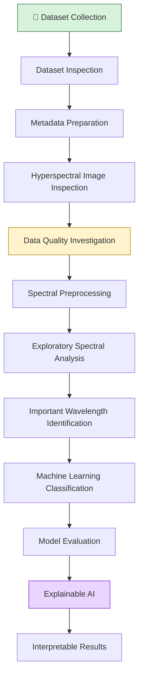

<div align="center">

# 🌱 TerraSpectra-AI

### Explainable Spectral Intelligence for Wheat Disease Detection

**Turning Hyperspectral Data into Explainable Agricultural Intelligence**

<br>


<br>

[📊 Dataset](#-dataset) · [🔬 Research](#-research-and-implementation) · [📈 Results](#-current-investigation-results) · [🛠️ Technologies](#️-technology-stack) · [🚀 Roadmap](#-project-roadmap)

</div>

---

## 🌍 About the Project

TerraSpectra-AI is an agricultural data science project that investigates hyperspectral imaging for wheat disease analysis.

It uses Visible-Near Infrared (VNIR) and Short-Wave Infrared (SWIR) data to explore spectral differences between infected and non-infected wheat leaf samples.

The project aims to combine:

- Hyperspectral Image Analysis
- Spectral Feature Investigation
- Important Wavelength Identification
- Machine Learning Classification
- Explainable Artificial Intelligence (XAI)

The goal is to develop a scientifically grounded and interpretable approach to wheat disease classification.

---

## 🎯 Project Highlights

| 🔍 Research Area | 💡 Project Focus |
|---|---|
| Hyperspectral Imaging | Analyse VNIR and SWIR measurements |
| Data Quality | Investigate unusual spectral values |
| Spectral Analysis | Explore wavelength-related patterns |
| Feature Identification | Identify informative wavelengths |
| Machine Learning | Classify infected and non-infected samples |
| Explainable AI | Understand model predictions |

---

## 🧭 Quick Navigation

<details open>
<summary><b>📚 Explore Project Documentation</b></summary>

- [Project Overview](#-about-the-project)
- [Problem Statement](#-problem-statement)
- [Objectives](#-research-objectives)
- [Dataset](#-dataset)
- [System Workflow](#️-system-workflow)
- [Technology Stack](#️-technology-stack)
- [Project Structure](#-project-structure)
- [Research and Implementation](#-research-and-implementation)
- [Current Investigation Results](#-current-investigation-results)
- [Visualization Gallery](#️-visualization-gallery)
- [Project Roadmap](#-project-roadmap)
- [Installation](#-getting-started)
- [Limitations](#️-research-limitations)

</details>

---

## ❗ Problem Statement

Traditional visual inspection may not reveal all spectral changes associated with plant disease.

Hyperspectral imaging provides measurements across multiple wavelengths, creating opportunities to investigate disease-related spectral patterns.

However, analysing this data requires careful handling of high-dimensional information, unusual pixel values, image coordinates, and model interpretability.

**TerraSpectra-AI investigates how hyperspectral analysis and explainable machine learning can help address these challenges.**

---

## 🎯 Research Objectives

- [x] Select a wheat disease hyperspectral dataset.
- [x] Inspect dataset metadata.
- [x] Prepare VNIR and SWIR annotation tables.
- [x] Inspect an actual SWIR hyperspectral image.
- [x] Investigate unusual maximum-value measurements.
- [x] Complete initial spatial maximum-value investigation.
- [x] Complete column-wise maximum-value investigation.
- [ ] Complete spatial quality validation.
- [ ] Extend processing to relevant samples.
- [ ] Identify important wavelengths.
- [ ] Develop disease classification models.
- [ ] Evaluate model performance.
- [ ] Apply Explainable AI techniques.

---

## 📊 Dataset

<details open>
<summary><b>Dataset Information</b></summary>

| Attribute | Details |
|---|---|
| Dataset | Early detection of Septoria infection on wheat leaves using hyperspectral imaging data |
| Repository | Recherche Data Gouv |
| DOI | `10.57745/WVP0FJ` |
| Crop | Wheat |
| Disease | Septoria |
| Modalities | VNIR and SWIR |
| Genotypes | EPO_67 and EPO_68 |
| Treatment groups | Infected and Non-infected |

**Dataset source:** [Open official dataset repository](https://entrepot.recherche.data.gouv.fr/dataset.xhtml?persistentId=doi:10.57745/WVP0FJ)

</details>

### 🔬 Inspected SWIR Sample

| Technical Specification | Value |
|---|---:|
| Image dimensions | 420 × 320 |
| Spectral bands | 256 |
| Wavelength range | 964.18–2494.39 nm |
| Source data type | uint16 |
| Interleave | BIL |
| Acquisition date | 11 March 2021 |

These specifications describe the inspected SWIR sample, not the entire dataset.

---

## ⚙️ System Workflow



*The diagram represents the planned end-to-end workflow, not a claim that every stage is implemented.*

---

## 🛠️ Technology Stack

| Technology | Application |
|---|---|
| 🐍 Python | Project implementation |
| 🔢 NumPy | Numerical computation |
| 🐼 Pandas | Dataset preparation |
| 📊 Matplotlib | Data visualization |
| 🔬 Spectral Python | Hyperspectral image inspection |
| 💻 VS Code | Development environment |
| 🌿 Git | Version control |
| 🐙 GitHub | Project hosting |

---

## 📂 Project Structure

<details>
<summary><b>Click to explore the project folders</b></summary>

```text
TerraSpectra-AI/
│
├── data/
│   ├── raw/
│   │   ├── Data_description.csv
│   │   ├── SWIR_data.csv
│   │   ├── VNIR_data.csv
│   │   └── SWIR_sample/
│   │
│   └── processed/
│       ├── SWIR_cleaned.csv
│       ├── SWIR_prepared.csv
│       ├── VNIR_cleaned.csv
│       ├── VNIR_prepared.csv
│       ├── SWIR_spatial_maximum_distribution.png
│       ├── SWIR_overall_maximum_heatmap.png
│       ├── SWIR_column_maximum_analysis.csv
│       └── SWIR_column_maximum_distribution.png
│
├── main.py
├── inspect_raw.py
├── inspect_swir.py
├── README.md
└── .gitignore
```

</details>

*The structure represents the local development workspace. Large raw files and ignored data may not be available in the GitHub repository.*

---

## 🔬 Research and Implementation

<details open>
<summary><b>Phase 1 — Dataset Inspection</b> ✅ Completed</summary>

- Inspected dataset metadata.
- Identified VNIR and SWIR data.
- Examined annotation information.

</details>

<details open>
<summary><b>Phase 2 — Metadata Preparation</b> ✅ Completed</summary>

Prepared annotation tables for both imaging modalities.

| Treatment | Records |
|---|---:|
| Infected | 24 |
| Non-infected | 24 |
| Total | 48 |

These are pot-level annotation records, not individual spectral images.

</details>

<details open>
<summary><b>Phase 3 — SWIR Image Inspection</b> ✅ Completed</summary>

- Loaded an actual SWIR hyperspectral image.
- Inspected its dimensions and wavelength information.
- Examined leaf-coordinate information.
- Investigated measurements in the selected leaf region.

</details>

<details open>
<summary><b>Phase 4 — Spectral Quality Investigation</b> ✅ Initial Investigation Completed</summary>

Investigated:

- Zero-valued measurements.
- Maximum stored values.
- Affected spectral bands.
- Leaf-region measurements.
- Neighbouring wavelength values.

Further technical validation remains necessary.

</details>

<details open>
<summary><b>Phase 5 — Spatial Maximum-Value Investigation</b> ✅ Completed</summary>

Generated:

- Spatial maximum-value distribution.
- Overall maximum-value heatmap.
- Band-wise spatial investigation.

</details>

<details open>
<summary><b>Phase 6 — Column-wise Maximum-Value Investigation</b> ✅ Completed</summary>

Investigated the distribution of maximum stored values (`65535`) across the 320 image columns.

Completed activities:

- Counted maximum-value occurrences across image columns.
- Identified columns with the highest counts.
- Generated a column-wise analysis CSV file.
- Created a column-wise maximum-value distribution graph.
- Examined the concentration of maximum-value occurrences.

**Generated outputs:**

- `SWIR_column_maximum_analysis.csv`
- `SWIR_column_maximum_distribution.png`

</details>

---

## 📈 Current Investigation Results

The inspected SWIR image contains:

| Measurement | Observed Result |
|---|---:|
| Total image values | 34,406,400 |
| Zero values | 527 |
| Maximum values (65,535) | 3,577 |
| NaN values | 0 |
| Infinite values | 0 |
| Leaf-coordinate pixels | 3,846 |
| Maximum values in leaf region | 92 |

### Affected Spectral Bands

| Band | Wavelength | Maximum Count |
|---:|---:|---:|
| 74 | 1408.24 nm | 11 |
| 87 | 1486.25 nm | 11 |
| 90 | 1504.25 nm | 12 |
| 92 | 1516.26 nm | 11 |
| 104 | 1588.27 nm | 11 |
| 121 | 1690.28 nm | 12 |
| 125 | 1714.28 nm | 12 |
| 255 | 2494.39 nm | 12 |

### Column-wise Maximum-Value Findings

The Section 17 investigation identified eight columns with 420 maximum-value occurrences each.

| Image Column | Maximum-Value Count |
|---:|---:|
| 14 | 420 |
| 33 | 420 |
| 135 | 420 |
| 290 | 420 |
| 292 | 420 |
| 296 | 420 |
| 300 | 420 |
| 302 | 420 |

Other columns also contained smaller numbers of maximum-value occurrences.

**Research interpretation:** Maximum-value occurrences are concentrated in particular image columns rather than being evenly distributed. This suggests a spatial pattern that deserves further investigation.

The counts are calculated across all image rows and spectral bands. They do not establish the cause of the pattern.

**Research note:** The maximum stored values have not been confirmed as sensor saturation or invalid measurements. Their meaning requires further investigation. No spectral values have been deleted or modified.

---

## 🖼️ Visualization Gallery

<details open>
<summary><b>📍 SWIR Spatial Maximum-Value Distribution</b></summary>


</details>

<details open>
<summary><b>🌡️ SWIR Overall Maximum-Value Heatmap</b></summary>


</details>

<details open>
<summary><b>📊 SWIR Column-wise Maximum-Value Distribution</b></summary>


</details>

<details>
<summary><b>Other Generated Visualizations</b></summary>

- SWIR leaf-coordinate verification.
- Maximum-value locations.
- Maximum-value comparison.
- Band-wise maximum-value comparison.

</details>

---

## 🚀 Project Roadmap

| Development Stage | Status |
|---|---|
| Dataset collection | 🟢 Completed for current working data |
| Metadata preparation | 🟢 Completed |
| SWIR image inspection | 🟢 Completed for one sample |
| Initial quality investigation | 🟢 Completed |
| Spatial maximum analysis | 🟢 Completed |
| Column-wise investigation | 🟢 Completed |
| Full spectral preprocessing | ⚪ Planned |
| Wavelength identification | ⚪ Planned |
| Disease classification | ⚪ Planned |
| Explainable AI | ⚪ Planned |
| Model evaluation | ⚪ Planned |

**Legend:** 🟢 Completed · 🟡 In Progress · ⚪ Planned

---

## 💻 Getting Started

### 1. Clone the repository

```bash
git clone https://github.com/sanjanamdinfo/TerraSpectra-AI.git
```

### 2. Open project directory

```bash
cd TerraSpectra-AI
```

### 3. Install dependencies

```bash
pip install numpy pandas matplotlib spectral
```

### 4. Execute metadata preparation

```bash
python main.py
```

### 5. Inspect raw dataset information

```bash
python inspect_raw.py
```

### 6. Run SWIR image inspection

```bash
python inspect_swir.py
```

**Note:** The SWIR script requires the corresponding local `.hdr`, `.hyspex`, and leaf-coordinate files. These raw sample files are not included in the repository.

---

## ⚠️ Research Limitations

- Current image-level findings are based on one inspected SWIR sample.
- The maximum stored values require technical validation.
- Coordinate orientation requires confirmation.
- Full-dataset spectral preprocessing is not yet completed.
- Disease classification and model performance have not yet been established.
- Early detection claims require suitable time-linked experimental validation.

---

## 🔮 Future Enhancements

- Complete spatial quality validation.
- Validate coordinate mapping.
- Expand SWIR and VNIR processing.
- Identify disease-related spectral patterns.
- Select informative wavelengths.
- Train machine learning models.
- Apply SHAP or other appropriate explainability methods.
- Compare full-spectrum and selected-wavelength models.
- Build an interactive results dashboard.

---

<div align="center">

## 🌱 Our Vision

**From hyperspectral measurements to interpretable agricultural intelligence.**

Building TerraSpectra-AI step by step with reliable data, transparent analysis, and explainable results.

<br>

⭐ If you find this project interesting, consider starring the repository!

[](https://github.com/sanjanamdinfo/TerraSpectra-AI)

</div>